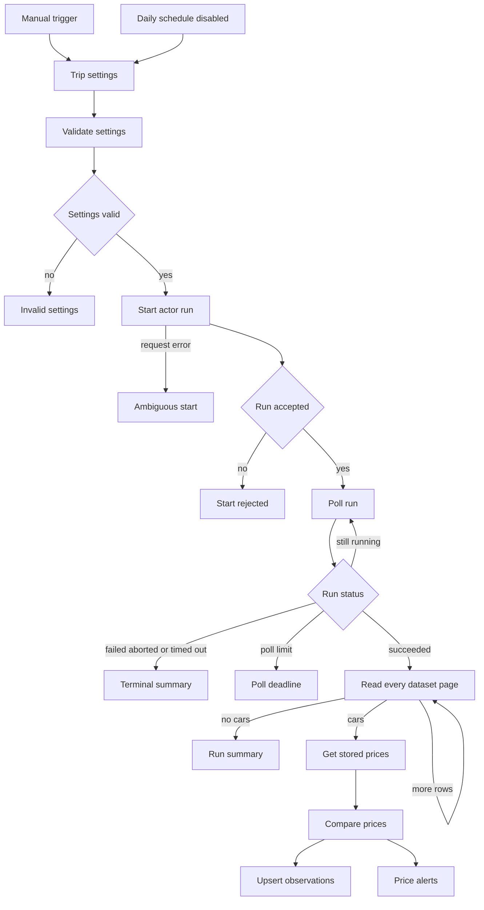

# How to compare a Turo trip price over time

Compare the same Turo trip, not two different searches. A daily price is only comparable when the place, pickup, drop-off, times, and driver age stay fixed. This walkthrough uses a free n8n workflow and the [Turo Car Scraper](https://apify.com/datascrapers/turo-car-scraper) actor from Data Scrapers. The workflow stores each observation and alerts when the average daily price or the trip total changes.

The template is free to download. Each actor run can cost money. On 2026-10-27 the actor's active pricing was pay per event, with a FREE-plan car event at $0.0015 and a start event at $0.00005 per gigabyte of memory, minimum one event.

## The problem and when this approach fits

Turo shows the cars available for the dates you ask about. That response is a snapshot. The actor does not keep yesterday's price, and a blocked calendar day does not include a daily rate. If you need a change over time, you have to run the same search again and store the earlier amount yourself.

Use the [price monitor](https://github.com/faizanalii/free-n8n-templates/blob/main/templates/turo-trip-price-monitor/README.md) when you care about one trip window. Use the [car table](https://github.com/faizanalii/free-n8n-templates/blob/main/templates/turo-cars-to-data-table/README.md) when you only need the current list. Use the [calendar template](https://github.com/faizanalii/free-n8n-templates/blob/main/templates/turo-availability-calendar/README.md) when you need busy dates. The calendar price field is null, so it is a poor source for a rate change.

## What you need

n8n 2.1.4 was the tested version. You also need an Apify account, a Header Auth credential with your own token, and an n8n data table whose columns match the price-monitor guide. Create the table before the first run. Leave the schedule off until a two-car manual run is cheap enough to repeat.

## How the automation works

The workflow validates the trip settings, starts the actor once, and polls that run. After it succeeds, it reads the dataset in pages of 10. It loads the rows already stored for the same start date, end date, driver age, and location. The first observation of each car is a baseline. A later run alerts when `avgDailyPrice` or `totalTripPrice` is different, including a change between null and a number. Null stays null. It is not treated as zero.

The setup steps and the field list are on the [price monitor page](https://github.com/faizanalii/free-n8n-templates/blob/main/templates/turo-trip-price-monitor/README.md).

## Configure and test

Start with `maxItems` at 2 or 10. Use a real place and dates you would actually compare, such as a city plus a pickup and drop-off a few days apart. Run it once and confirm **Price alerts** says a baseline was saved. Run the same settings again. With no source change, the alert result is `no_change` and the table still has one row per car.

A fixture test on 2026-10-27 stored a car at 40 and then saw 55 for the same key. The alert carried both amounts. A second car at 50 stayed `unchanged`. A live two-car San Francisco search on the export workflow, which uses the same actor input, reported `usageTotalUsd` 0.00393.

## Operate it safely

Turn the schedule on only after the baseline looks right. Keep one run at a time for the same table. The workflow stops polling after about 10 minutes and does not abort the remote run, so a deadline message still needs a look in Apify. Do not mix currencies or driver ages in one comparison. A car that disappears from a capped result is not marked deleted.

## Download the workflow

[Download the workflow JSON](https://raw.githubusercontent.com/faizanalii/free-n8n-templates/main/templates/turo-trip-price-monitor/workflow.json). The import and credential steps are in the [template guide](https://github.com/faizanalii/free-n8n-templates/blob/main/templates/turo-trip-price-monitor/README.md). The actor is [Turo Car Scraper](https://apify.com/datascrapers/turo-car-scraper), published by Data Scrapers. The template was tested on 2026-10-27.
