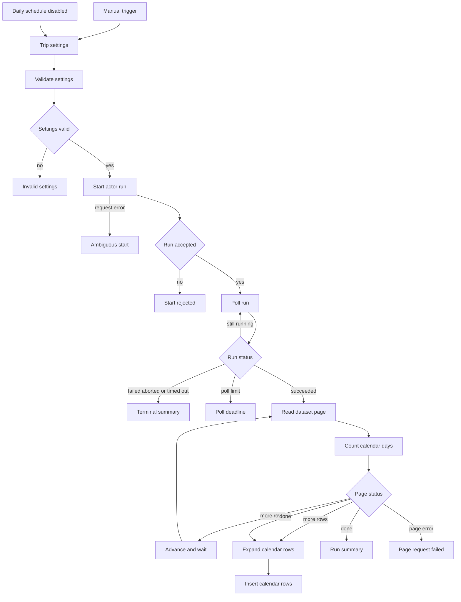

# Save Turo calendar days for a trip search

This workflow collects the booking calendar for the cars in one Turo search and stores one row per calendar day. Each row says whether that date is unavailable. The actor's calendar price and currency are null. A blocked day is a busy date on the public calendar. It does not tell you whether a guest booked it.

**Free template. Apify runs can incur charges.**
Built by Data Scrapers using [Turo Car Scraper](https://apify.com/datascrapers/turo-car-scraper).

## Download
[Download workflow JSON](https://raw.githubusercontent.com/faizanalii/free-n8n-templates/main/templates/turo-availability-calendar/workflow.json) · [View source](https://github.com/faizanalii/free-n8n-templates/tree/main/templates/turo-availability-calendar)

## What this does
The workflow sends `includeAvailability` and your `maxAvailabilityDays`, then writes each returned day to a data table. The summary counts unavailable and open days whose date is on or after the trip start and before the trip end. Days outside that window can still be stored when the calendar cap is longer than the trip.

## Workflow


The start, 10-second poll, terminal branches, and 10-item dataset pages match the [car export template](https://github.com/faizanalii/free-n8n-templates/blob/main/templates/turo-cars-to-data-table/README.md).

## Requirements
Tested on n8n 2.1.4. You need an Apify account and a Header Auth credential:

- Credential type: Header Auth
- Name: `Authorization`
- Value: `Bearer` followed by your Apify API token

Create the data table and columns below before the first run. Paste its ID into **Trip settings**. The Data table nodes read that ID. Leave **Daily schedule** disabled until the manual test looks right.

Columns: `vehicleId` number, `make` string, `model` string, `year` number, `url` string, `date` string, `unavailable` boolean, `price` number, `currency` string, `customPrice` boolean, `inTrip` boolean, `tripStart` string, `tripEnd` string, `locationQuery` string, `observedAt` string, `runId` string.

`maxAvailabilityDays` must be from 1 to 31. `maxItems` must be from 1 to 10. Each saved day is an availability event.

## Setup
1. Download `workflow.json` with the raw link above. Saving the GitHub HTML page will not import.
2. In n8n, import from file.
3. Create the Header Auth credential and select it on **Start actor run**, **Get run**, and **Get dataset page**.
4. Create a data table with the columns in the next section. Copy the table ID into **Trip settings**.
5. Set the location, trip dates, pickup and drop-off times, driver age, and `maxItems`.
6. Leave the schedule disabled. Run it once with the manual trigger.
7. Open the data table and confirm the rows. Then read the execution's **Run summary** or **Price alerts** node.
8. Turn on the daily schedule only after you accept the actor cost and the timezone of the n8n instance.

Set a small `maxItems` and a short calendar on the first manual run. Each car can add as many day rows as `maxAvailabilityDays`.

## Inputs and output
Defaults are Los Angeles, 2026-12-01 to 2026-12-05, 10:00, driver age 30, `maxItems` 5, and 14 calendar days. `inTrip` is true when the calendar date is greater than or equal to `startDate` and less than `endDate`. The drop-off date is not counted as a full day in that summary.

`price` and `currency` stay null. `customPrice` is false for this calendar. `unavailable` true means the public calendar marks the date busy.

Synthetic example:

```json
{
  "vehicleId": 501,
  "date": "2026-12-02",
  "unavailable": true,
  "price": null,
  "currency": null,
  "customPrice": false,
  "inTrip": true,
  "synthetic": true
}
```

## Costs and limits

Pricing was read from the actor pricing API on 2026-10-27. The schedule in effect that day started on 2026-10-15 and is pay per event. FREE-plan event prices were:

| Event | When it is charged | FREE-plan price |
|---|---|---:|
| Actor start | Once per gigabyte of run memory, with a minimum of one event | $0.00005 |
| car | Each car saved by the actor | $0.0015 |
| availability | Each calendar day saved | $0.0009 |
| car-details | Only when car details are enabled | $0.002 |
| host | Only when host profiles are enabled | $0.002 |
| car-review | Each car review saved | $0.0015 |
| host-review | Each host review saved | $0.0015 |

These templates do not turn on car details, host profiles, or reviews. The availability template is the only one that turns on calendar days. A later price schedule is set to start on 2026-10-31, with a FREE-plan car price of $0.00176 and an availability price of $0.001005. Other Apify plans list lower event prices. Open the [actor pricing tab](https://apify.com/datascrapers/turo-car-scraper) before a large run. One live test run on 2026-10-27, with `maxItems` 2 and the optional switches off, reported `usageTotalUsd` of 0.00393. That figure is the total reported for that run, not a quote for every search.

Five cars and 14 days can be about 70 availability events, or $0.063 at the FREE-plan day price, plus the car events and the start event. The exact count depends on how many days the actor returns.

## First run, repeated runs and empty results
Each run inserts the days it receives. It does not update an earlier day in place. Keep `runId` or `observedAt` so repeated runs do not look like one calendar. An empty calendar writes nothing and the summary says no days were returned. A missing car in a later run is not deleted from the table.

## Troubleshooting
If the summary counts days but the table is empty, the insert failed and the execution should show that error. If every `price` is null, that is the calendar this actor returns. Do not fill those cells with the search-card daily price. They are different numbers. The car's `avgDailyPrice` is on the [car export template](https://github.com/faizanalii/free-n8n-templates/blob/main/templates/turo-cars-to-data-table/README.md), not on these day rows.

## Verification and limitations
Checked on n8n 2.1.4 on 2026-10-27. A fixture search with two cars and three days stored 6 rows: 1 unavailable day and 5 open days inside the trip window. Every fixture price and currency was null. The shared start, poll, failure, and pagination branches were tested on the car export workflow, including a fresh import. This file was imported from the portable JSON and executed after a local data table was selected. The schedule was not activated. The actor does not explain why a date is busy, and it does not provide a daily calendar price. Diagram rendering was not checked with a Mermaid image renderer.

## Related resources
- [Save Turo cars to a data table](https://github.com/faizanalii/free-n8n-templates/blob/main/templates/turo-cars-to-data-table/README.md)
- [Monitor Turo trip prices](https://github.com/faizanalii/free-n8n-templates/blob/main/templates/turo-trip-price-monitor/README.md)
- [How to compare a Turo trip price over time](https://github.com/faizanalii/free-n8n-templates/blob/main/articles/monitor-turo-trip-prices.md)
- [Turo Car Scraper](https://apify.com/datascrapers/turo-car-scraper)

## License and attribution
This repository does not include a license file. Data Scrapers publishes the template for free download. The actor is a separate paid Apify product. Support for the actor: stardustspotlight@gmail.com.
