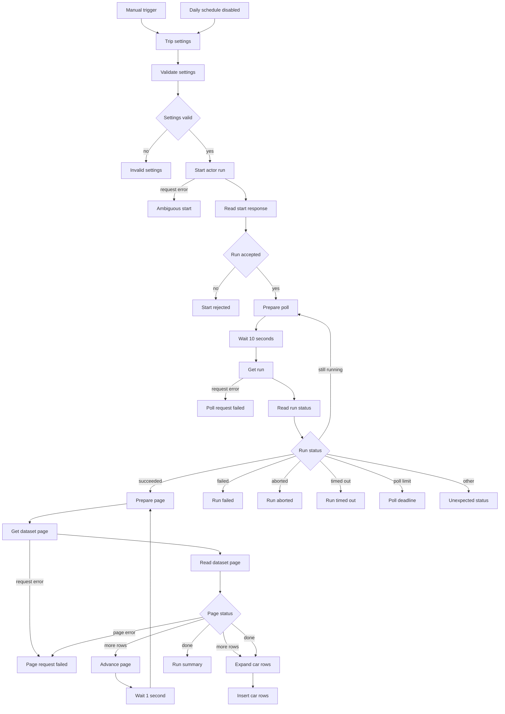

# Save a Turo car search to an n8n data table

This workflow searches Turo for one place and one trip window, then stores one row per car in an n8n data table. Each row has the vehicle, the average daily price, the trip total when Turo returns one, the listing URL, and the run time. It is a snapshot of that search. It does not book a car or keep a price history by itself.

**Free template. Apify runs can incur charges.**
Built by Data Scrapers using [Turo Car Scraper](https://apify.com/datascrapers/turo-car-scraper).

## Download
[Download workflow JSON](https://raw.githubusercontent.com/faizanalii/free-n8n-templates/main/templates/turo-cars-to-data-table/workflow.json) · [View source](https://github.com/faizanalii/free-n8n-templates/tree/main/templates/turo-cars-to-data-table)

## What this does
You set a city, pickup and drop-off dates and times, a driver age, and a car cap. The workflow starts [Turo Car Scraper](https://apify.com/datascrapers/turo-car-scraper) once, stores the run ID, polls that same run, and inserts each dataset page into your table. A successful test is a data table with one row per returned car and a **Run summary** that matches the row count.

## Workflow


## Requirements
Tested on n8n 2.1.4. You need an Apify account and a Header Auth credential:

- Credential type: Header Auth
- Name: `Authorization`
- Value: `Bearer` followed by your Apify API token

Create the data table and columns below before the first run. Paste its ID into **Trip settings**. The Data table nodes read that ID. Leave **Daily schedule** disabled until the manual test looks right.

Data table columns: `vehicleId` number, `url` string, `make` string, `model` string, `year` number, `vehicleType` string, `rating` number, `completedTrips` number, `isAllStarHost` boolean, `hostId` number, `city` string, `state` string, `country` string, `distanceMiles` number, `avgDailyPrice` number, `currency` string, `totalTripPrice` number, `badges` string, `tripStart` string, `tripEnd` string, `locationQuery` string, `observedAt` string, `runId` string.

## Setup
1. Download `workflow.json` with the raw link above. Saving the GitHub HTML page will not import.
2. In n8n, import from file.
3. Create the Header Auth credential and select it on **Start actor run**, **Get run**, and **Get dataset page**.
4. Create a data table with the columns in the next section. Copy the table ID into **Trip settings**.
5. Set the location, trip dates, pickup and drop-off times, driver age, and `maxItems`.
6. Leave the schedule disabled. Run it once with the manual trigger.
7. Open the data table and confirm the rows. Then read the execution's **Run summary** or **Price alerts** node.
8. Turn on the daily schedule only after you accept the actor cost and the timezone of the n8n instance.

## Inputs and output
The default trip settings search Los Angeles from 2026-12-01 to 2026-12-05, at 10:00, for a driver age of 30, with `maxItems` 25. The template ceiling is 100 cars. `maxItems` of 0 is rejected here because the actor treats 0 as no cap.

`avgDailyPrice` is the search-card daily amount. `totalTripPrice` is null when the search has no estimated quote. Null does not mean the trip is free. `badges` is a comma-separated string because the data table cannot store an array. Car details, host profiles, reviews, and the calendar are left off, so those nested fields are not columns.

This sample is synthetic:

```json
{
  "vehicleId": 1001,
  "make": "Example",
  "model": "Sample",
  "year": 2022,
  "avgDailyPrice": 80,
  "currency": "USD",
  "totalTripPrice": null,
  "tripStart": "2026-12-01T10:00",
  "tripEnd": "2026-12-05T10:00",
  "locationQuery": "Los Angeles, CA, USA",
  "runId": "example-run",
  "synthetic": true
}
```

## Costs and limits

Pricing was read from the actor pricing API on 2026-10-27. The schedule in effect that day started on 2026-10-15 and is pay per event. FREE-plan event prices were:

| Event | When it is charged | FREE-plan price |
|---|---|---:|
| Actor start | Once per gigabyte of run memory, with a minimum of one event | $0.00005 |
| car | Each car saved by the actor | $0.0015 |
| availability | Each calendar day saved | $0.0009 |
| car-details | Only when car details are enabled | $0.002 |
| host | Only when host profiles are enabled | $0.002 |
| car-review | Each car review saved | $0.0015 |
| host-review | Each host review saved | $0.0015 |

These templates do not turn on car details, host profiles, or reviews. The availability template is the only one that turns on calendar days. A later price schedule is set to start on 2026-10-31, with a FREE-plan car price of $0.00176 and an availability price of $0.001005. Other Apify plans list lower event prices. Open the [actor pricing tab](https://apify.com/datascrapers/turo-car-scraper) before a large run. One live test run on 2026-10-27, with `maxItems` 2 and the optional switches off, reported `usageTotalUsd` of 0.00393. That figure is the total reported for that run, not a quote for every search.

A 25-car run at the FREE-plan car price is about $0.0375 in car events, plus at least one start event. Platform usage can change the total. The template stops polling after 60 checks, about 10 minutes, and does not abort the actor. A polling deadline can leave a run billing on Apify.

## First run, repeated runs and empty results
Every manual run inserts the cars it receives. Running it again adds more rows for the same cars. This workflow does not deduplicate. Use `vehicleId` with `tripStart`, `tripEnd`, and `runId` if you compare rows later.

An empty dataset ends on **Run summary** with `result` `empty` and writes no rows. A failed, aborted, or timed-out actor run does not insert rows. If the start request errors before a run ID is saved, check Apify before starting again. The start node does not retry.

Two manual runs can insert the same car at the same time. The template does not claim exactly-once delivery.

## Troubleshooting
- **Invalid settings** runs before any actor start. Read the `errors` list.
- **Ambiguous start** means n8n did not receive a run ID. Look for a new run in Apify before you run the workflow again.
- **Start rejected** means Apify answered without a run ID. The `message` field is the response text.
- **Poll deadline** includes the run ID. Open that run in Apify. This workflow does not abort it.
- **Page request failed** keeps rows already inserted and does not start a second run.
- Missing price or trip total stays null. Do not replace null with zero.

## Verification and limitations
Checked on n8n 2.1.4 on 2026-10-27. Fixture runs covered invalid input, an empty dataset, failed, aborted, and timed-out statuses, a rejected start, a connection error on start, a run that stayed in progress for two polls, and 12 cars across two pages. The portable `workflow.json` was imported again and the 12-row page test passed. A live run for San Francisco with `maxItems` 2 stored 2 cars and reported `usageTotalUsd` 0.00393. Both live trip totals were null.

The actor returns the cars Turo shows for that query. It does not promise every car in a city. One map response holds at most 200 cars. The result is a current snapshot, not a booking history. The daily schedule was left disabled and was not activated during the test. Diagram rendering was not checked with a Mermaid image renderer.

## Related resources
- [Monitor Turo trip prices](https://github.com/faizanalii/free-n8n-templates/blob/main/templates/turo-trip-price-monitor/README.md)
- [Save Turo availability days](https://github.com/faizanalii/free-n8n-templates/blob/main/templates/turo-availability-calendar/README.md)
- [How to compare a Turo trip price over time](https://github.com/faizanalii/free-n8n-templates/blob/main/articles/monitor-turo-trip-prices.md)
- [Turo Car Scraper](https://apify.com/datascrapers/turo-car-scraper)

## License and attribution
This repository does not include a license file. Data Scrapers publishes the template for free download. The actor is a separate paid Apify product. Support for the actor: stardustspotlight@gmail.com.
