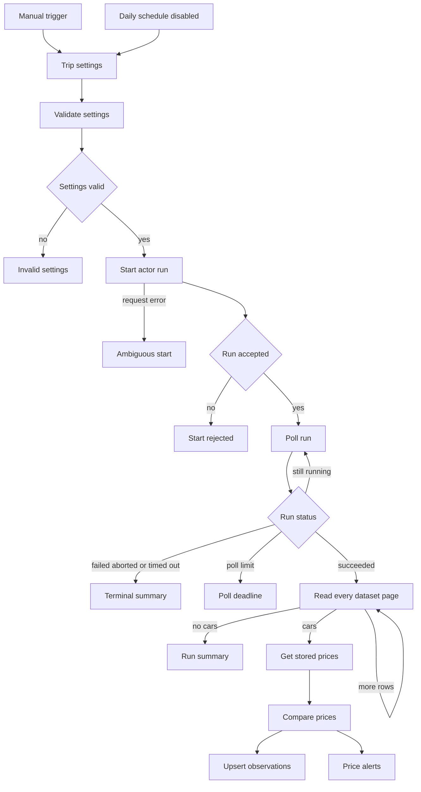

# Monitor Turo prices for the same trip

This workflow repeats one Turo search and tells you when the average daily price or the trip total changes. The first successful run stores a baseline and does not raise an alert. Later runs alert only for a new car or a changed amount, using the same vehicle, trip dates, driver age, currency, and location.

**Free template. Apify runs can incur charges.**
Built by Data Scrapers using [Turo Car Scraper](https://apify.com/datascrapers/turo-car-scraper).

## Download
[Download workflow JSON](https://raw.githubusercontent.com/faizanalii/free-n8n-templates/main/templates/turo-trip-price-monitor/workflow.json) · [View source](https://github.com/faizanalii/free-n8n-templates/tree/main/templates/turo-trip-price-monitor)

## What this does
The workflow starts the actor once for the trip settings, reads every dataset page, and compares each car with the row already stored for that observation. A useful result is either a baseline summary or one **Price alerts** item per change. Unchanged cars stay in the table and are not alert rows.

## Workflow


Polling, dataset pages, and the terminal branches use the same start, wait, and page nodes as the [car export template](https://github.com/faizanalii/free-n8n-templates/blob/main/templates/turo-cars-to-data-table/README.md). The diagram above keeps those loops in the poll and page nodes so the price steps stay readable. The executable workflow still waits 10 seconds between status checks, pages 10 cars at a time, and waits 1 second between pages.

## Requirements
Tested on n8n 2.1.4. You need an Apify account and a Header Auth credential:

- Credential type: Header Auth
- Name: `Authorization`
- Value: `Bearer` followed by your Apify API token

Create the data table and columns below before the first run. Paste its ID into **Trip settings**. The Data table nodes read that ID. Leave **Daily schedule** disabled until the manual test looks right.

Use a separate data table from the car export. Columns: `observationKey` string, `vehicleId` string, `searchStart` string, `searchEnd` string, `tripStart` string, `tripEnd` string, `driverAge` string, `locationQuery` string, `currency` string, `avgDailyPrice` number, `totalTripPrice` number, `previousAvgDailyPrice` number, `previousTotalTripPrice` number, `changeType` string, `observedAt` string, `make` string, `model` string, `year` string, `url` string, `runId` string.

The observation key is `vehicleId`, the car's trip start, trip end, driver age, currency, and the location you typed. Compare prices only when those stay the same. A null amount is not zero.

## Setup
1. Download `workflow.json` with the raw link above. Saving the GitHub HTML page will not import.
2. In n8n, import from file.
3. Create the Header Auth credential and select it on **Start actor run**, **Get run**, and **Get dataset page**.
4. Create a data table with the columns in the next section. Copy the table ID into **Trip settings**.
5. Set the location, trip dates, pickup and drop-off times, driver age, and `maxItems`.
6. Leave the schedule disabled. Run it once with the manual trigger.
7. Open the data table and confirm the rows. Then read the execution's **Run summary** or **Price alerts** node.
8. Turn on the daily schedule only after you accept the actor cost and the timezone of the n8n instance.

Keep the same location, dates, times, and driver age when you want a real comparison. Changing any of them creates a new observation key.

## Inputs and output
Defaults are Los Angeles, 2026-12-01 to 2026-12-05, 10:00, driver age 30, and `maxItems` 10. The ceiling in this template is 50.

`changeType` is `baseline` on the first observation of a search, `new_listing` when a car appears after that baseline exists, `price_change` when `avgDailyPrice` or `totalTripPrice` differs, and `unchanged` when both amounts match. **Price alerts** returns the change rows. When nothing changed, it returns one item with `changeType` `baseline` or `no_change` and a message. That item is not a vehicle.

Synthetic example of an alert:

```json
{
  "observationKey": "501|2026-12-01T10:00|2026-12-05T10:00|30|USD|Los Angeles, CA, USA",
  "vehicleId": "501",
  "avgDailyPrice": 55,
  "previousAvgDailyPrice": 40,
  "totalTripPrice": null,
  "previousTotalTripPrice": null,
  "currency": "USD",
  "changeType": "price_change",
  "synthetic": true
}
```

## Costs and limits

Pricing was read from the actor pricing API on 2026-10-27. The schedule in effect that day started on 2026-10-15 and is pay per event. FREE-plan event prices were:

| Event | When it is charged | FREE-plan price |
|---|---|---:|
| Actor start | Once per gigabyte of run memory, with a minimum of one event | $0.00005 |
| car | Each car saved by the actor | $0.0015 |
| availability | Each calendar day saved | $0.0009 |
| car-details | Only when car details are enabled | $0.002 |
| host | Only when host profiles are enabled | $0.002 |
| car-review | Each car review saved | $0.0015 |
| host-review | Each host review saved | $0.0015 |

These templates do not turn on car details, host profiles, or reviews. The availability template is the only one that turns on calendar days. A later price schedule is set to start on 2026-10-31, with a FREE-plan car price of $0.00176 and an availability price of $0.001005. Other Apify plans list lower event prices. Open the [actor pricing tab](https://apify.com/datascrapers/turo-car-scraper) before a large run. One live test run on 2026-10-27, with `maxItems` 2 and the optional switches off, reported `usageTotalUsd` of 0.00393. That figure is the total reported for that run, not a quote for every search.

## First run, repeated runs and empty results
The first run writes every car as `baseline` and the alert output says the baseline was saved. The second run compares against those rows. A fixture test moved one car from 40 to 55 and left the other car at 50. Only the changed car was an alert, and the table still held two rows.

An empty search does not delete stored prices. A car missing from a capped search is not treated as removed. Two overlapping runs can upsert the same key; run one schedule at a time. The data table is the state. A value left only in a previous execution is not enough.

## Troubleshooting
Use the same troubleshooting as the export template for rejected starts, polling deadlines, and page errors. If every run says baseline, the data table ID changed or the trip settings no longer match `searchStart`, `searchEnd`, `driverAge`, and `locationQuery`. If a null trip total becomes a number, that is a `price_change`, not a free trip becoming paid.

## Verification and limitations
Checked on n8n 2.1.4 on 2026-10-27. The shared actor branches were tested on the export workflow. This workflow was imported from the portable JSON and executed twice against one data table: the first run stored two baseline rows, and the second run alerted a 40 to 55 change. A separate run accumulated 12 cars from two dataset pages into 12 baseline rows. The schedule was not activated. Prices are comparable only for the same dates, times, age, currency, and place. The actor does not provide a historical price archive. Diagram rendering was not checked with a Mermaid image renderer.

## Related resources
- [Save Turo cars to a data table](https://github.com/faizanalii/free-n8n-templates/blob/main/templates/turo-cars-to-data-table/README.md)
- [Save Turo availability days](https://github.com/faizanalii/free-n8n-templates/blob/main/templates/turo-availability-calendar/README.md)
- [How to compare a Turo trip price over time](https://github.com/faizanalii/free-n8n-templates/blob/main/articles/monitor-turo-trip-prices.md)
- [Turo Car Scraper](https://apify.com/datascrapers/turo-car-scraper)

## License and attribution
This repository does not include a license file. Data Scrapers publishes the template for free download. The actor is a separate paid Apify product. Support for the actor: stardustspotlight@gmail.com.
